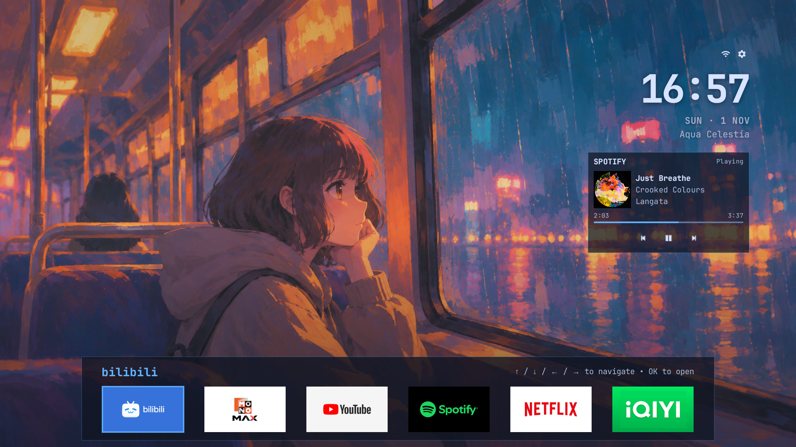
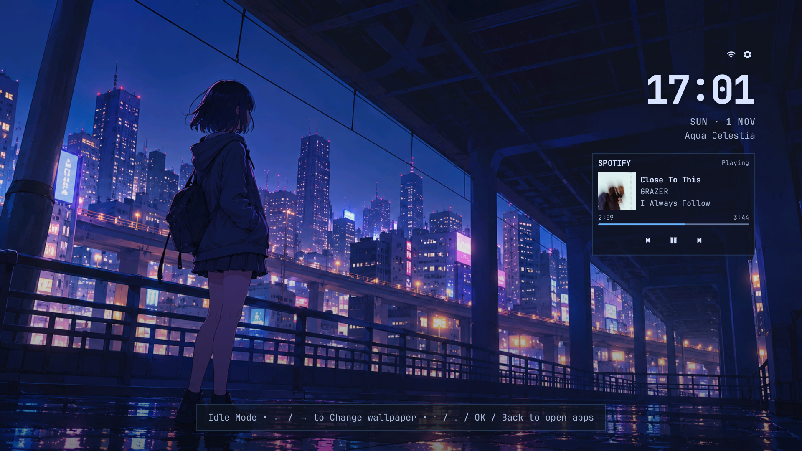

# CleanYourTV — custom TV build

Downstairs is done. Next, I'll move upstairs. :D





All message below generated from Codex

## Files included for use on another computer or TV

- `distribution/apk/CleanYourTV.apk` — built and signed APK.
- `distribution/theme/config.json` — random wallpaper slideshow every 2 minutes, showing the full collection before starting a new shuffled cycle.
- `distribution/theme/wallpapers/` — latest images from `tv_wall`, with no additional horizontal flipping.
- `distribution/manifest.json` and `distribution/SHA256SUMS` — file inventory and checksums.
- `custom/build.ps1` / `custom/build.sh` — run the build, tests, and lint, then update the distribution APK.
- `tools/install_custom_bundle.py` — install the APK and wallpapers through adb, checking each uploaded file's checksum on the TV.

Wallpapers are separate from the APK. Install both parts using the script below. Installing only the APK on a new TV will not include this wallpaper collection.

## Install the included APK on another TV

Requirements: Python 3.9+, Android SDK Platform-Tools (`adb`), and a TV running Android 8.0+ with ADB access authorized.
Gradle and a JDK are not required when using the included APK.

Run these commands from the repository root:

```text
adb connect YOUR_TV_IP:5555
python tools/install_custom_bundle.py --serial YOUR_TV_IP:5555
```

On macOS/Linux, use `python3` instead of `python` if needed. For USB connections, use the serial shown by `adb devices`.
If adb is not in PATH, add `--adb PATH_TO_ADB` to the installation command.

Verify the local bundle without connecting to or modifying a TV:

```text
python tools/install_custom_bundle.py --dry-run
```

The installer updates the app while preserving its data and **replaces the app's wallpaper collection with the images in distribution**.
It does not uninstall apps, disable the manufacturer's launcher, or change the system's default Home app.
To use this launcher as the default, select it in the TV's Home app settings.

For Spotify, enable Notification Access for **Spotify Now Playing**, then play music in Spotify on the TV.
Return to Home to display the widget. No Spotify token or Web API setup is required.

## Build on another computer

Install JDK 17, Python 3.9+, Android SDK Platform 34, Build-Tools 34.0.0, and Platform-Tools.
Set `JAVA_HOME` and `ANDROID_HOME` to the appropriate locations on that computer. The Gradle Wrapper downloads Gradle 8.9 and dependencies on the first build.
You do not need to copy `local.properties` from the original computer.

From the repository root on Windows PowerShell:

```powershell
powershell -NoProfile -ExecutionPolicy Bypass -File custom/build.ps1
```

From the repository root on macOS/Linux:

```bash
bash custom/build.sh
```

The new APK is written to `distribution/apk/CleanYourTV.apk`, together with updated manifest and checksum files.
Then use the installation script described above.

### Signing key for updates to an existing installation

The package name is `com.gathin.tvhome.terminal`. This release build uses Android debug signing.
**Building on another computer to update an existing installation requires the original signing key.**
Transfer the original `debug.keystore` privately, then set `ANDROID_USER_HOME` to the folder containing that file before building.
A build signed with a new key can be installed on a new TV, but cannot update an app signed with the original key.
The APK already included in distribution can update the current installation without transferring the private key.
No private signing keys, ADB keys, tokens, or passwords are included in this Git bundle.
The installer stops on a signature mismatch; it does not automatically uninstall the app or clear its data.

## Update wallpapers later

Edit or add images in `distribution/theme/wallpapers/`. Use filenames containing English letters, numbers, `_`, `-`, or `.`, with a png/jpg/jpeg/webp extension.
The existing wallpaper system supports up to 100 images, each at most 10 MB and up to 4K resolution.
Images are used as stored, with no additional horizontal flipping.

Build again, or, if only the images have changed, run:

```text
python tools/update_custom_manifest.py
```

Then run `tools/install_custom_bundle.py` to install the updated bundle.